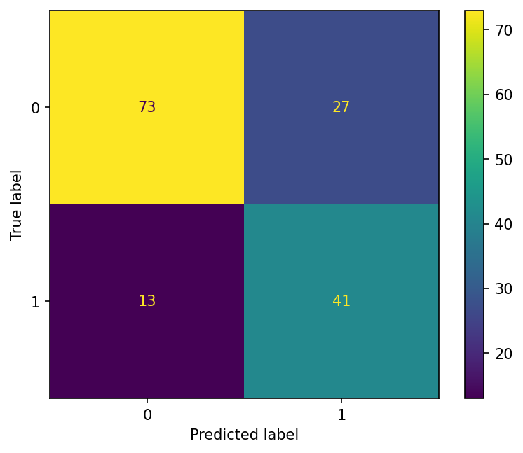
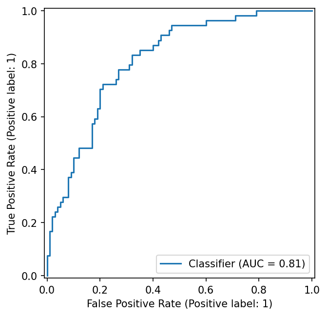
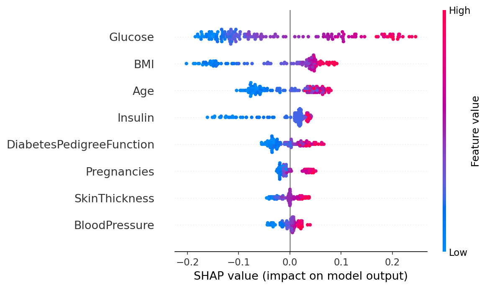

# Early Diabetes Risk Prediction using Machine Learning

A machine learning project that estimates a person's risk of diabetes from basic clinical measurements, built as a class project at Brainware University.

## Overview
- Compares Logistic Regression, Random Forest, SVM and XGBoost
- Handles invalid zero values as missing data (median imputation inside a pipeline to prevent data leakage)
- Uses stratified 5-fold cross-validation and grid search tuning
- Focuses on **recall** and **ROC-AUC**, since missing a diabetic patient is the costlier error
- Explains predictions with **SHAP**

## Project Structure
```text
diabetes-risk-prediction/
├── diabetes_risk_prediction.ipynb   # Main notebook with analysis, model pipeline & visible outputs
├── data/
│   └── diabetes.csv                 # Pima Indians Diabetes Database
├── images/                          # Saved evaluation and explainability plots
│   ├── confusion_matrix.png
│   ├── roc_curve.png
│   └── shap_summary.png
├── requirements.txt                 # Python project dependencies
├── .gitignore                       # Git ignore rules
└── README.md                        # Project documentation
```

## Dataset
Pima Indians Diabetes Database (768 records, 8 features, binary outcome).
Source: UCI / National Institute of Diabetes and Digestive and Kidney Diseases, available on Kaggle:
https://www.kaggle.com/datasets/uciml/pima-indians-diabetes-database

## Results

| Metric (test set) | Value |
|---|---|
| Accuracy | 74.0% |
| Recall | 76.0% |
| Precision | 60.0% |
| ROC-AUC | 0.814 |

**Best Model**: Tuned Random Forest Classifier (`max_depth=4`, `min_samples_leaf=5`, `n_estimators=400`, `class_weight='balanced'`).  
**Top Features by SHAP**: Glucose, BMI, Age, Pregnancies.

### Visualizations

| Confusion Matrix | ROC Curve |
| :---: | :---: |
|  |  |

### SHAP Feature Importance & Summary


## Tech Stack
Python, pandas, NumPy, scikit-learn, XGBoost, SHAP, Matplotlib, Seaborn

## How to Run

```bash
git clone https://github.com/Rajesh-dev-stack/diabetes-risk-prediction.git
cd diabetes-risk-prediction
pip install -r requirements.txt
jupyter notebook diabetes_risk_prediction.ipynb
```

## Limitations
The dataset is small and covers only women of Pima Indian heritage aged 21 and above, so results may not generalise to other populations. This is an educational risk screening project and **not a medical diagnostic tool**.

## Author
Rajesh | [LinkedIn](https://linkedin.com/in/dev-virtuoso) | [GitHub](https://github.com/Rajesh-dev-stack)
